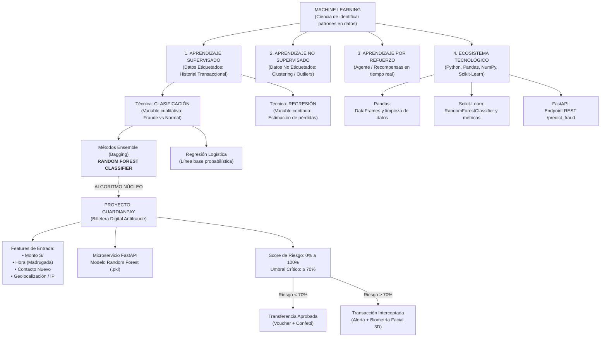
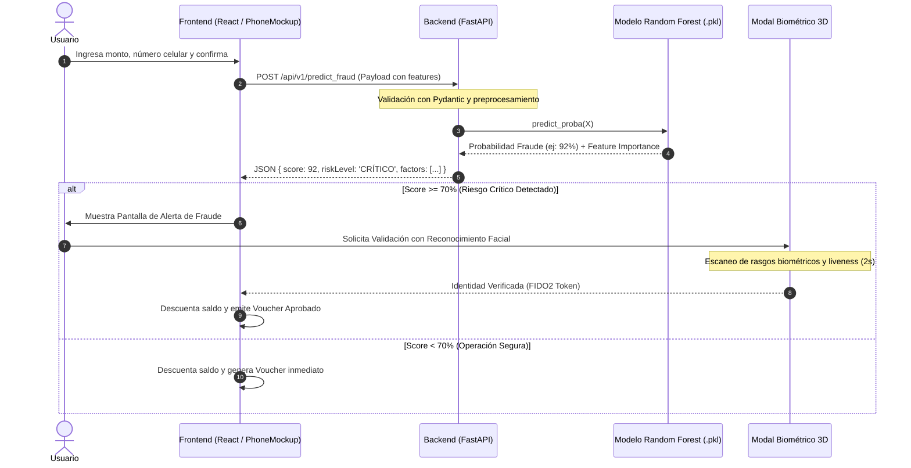

# Documento de Investigación y Aplicación: Machine Learning en GuardianPay
## Detección Predictiva de Fraudes en Billeteras Digitales Mediante Machine Learning (Random Forest)

> **Asignatura:** Innovación y Transformación Digital (Semana 13 - UTP)  
> **Proyecto:** GuardianPay - Billetera Digital Fintech con Prevención Activa de Fraude  
> **Modalidad:** CGT  
> **Objetivo de la Actividad:** Representar el tema del proyecto con Machine Learning, investigando tipos, técnicas, algoritmos, herramientas aplicadas y organizador conceptual de ideas.

---

## 1. Marco Teórico e Investigación de Machine Learning (Fundamentos UTP Semana 13)

### 1.1 ¿Qué es Machine Learning?
Tal como se define en la sesión académica, el **Machine Learning (Aprendizaje Automático)** es la rama de la Inteligencia Artificial y la ciencia computacional encargada de desarrollar algoritmos capaces de **identificar patrones complejos a partir de datos históricos con el fin de resolver un problema de interés**, sin necesidad de estar explícitamente programados regla por regla.

En el sector financiero y de pagos digitales (Fintech), el Machine Learning transforma los antiguos sistemas rígidos basados en reglas manuales (if/else) en **motores predictivos adaptativos** que aprenden del comportamiento legítimo y anómalo de millones de transacciones.

### 1.2 Utilidad del Machine Learning en la Sociedad y en Finanzas
Las aplicaciones clave abordadas en clase incluyen:
1. **Seguridad Informática y Prevención de Fraude:** Diagnóstico de ciberataques, detección de anomalías bancarias y protección de pasarelas de pago en tiempo real (*Núcleo central de GuardianPay*).
2. **Reconocimiento de Patrones e Imágenes:** Validación de biometría facial y dactilar (*Módulo de autenticación biométrica en GuardianPay*).
3. **Análisis de Mercados y Predicciones Financieras:** Detección de riesgo crediticio, volatilidad y proyección de transacciones.
4. **Conducción Autónoma y Salud:** Diagnóstico asistido y visión computacional.
5. **Sistemas de Recomendación:** Personalización de servicios y productos.

---

### 1.3 Tipos de Machine Learning y su Taxonomía

```
                           ┌──────────────────────────────────────────────┐
                           │             MACHINE LEARNING                 │
                           └──────────────────────┬───────────────────────┘
                                                  │
            ┌─────────────────────────────────────┼─────────────────────────────────────┐
            ▼                                     ▼                                     ▼
┌───────────────────────┐             ┌───────────────────────┐             ┌───────────────────────┐
│ APRENDIZAJE           │             │ APRENDIZAJE           │             │ APRENDIZAJE POR       │
│ SUPERVISADO           │             │ NO SUPERVISADO        │             │ REFUERZO              │
├───────────────────────┤             ├───────────────────────┤             ├───────────────────────┤
│ • Datos ETIQUETADOS   │             │ • Datos NO ETIQUETADOS│             │ • Agente, Ambiente y  │
│   (Inputs + Targets)  │             │ • Descubre patrones   │             │   Recompensas (+/-)   │
│ • Problemas:          │             │   y agrupamientos     │             │ • Aprende por ensayo  │
│   - Clasificación     │             │ • Problemas:          │             │   y error             │
│   - Regresión         │             │   - Clustering        │             │ • Usos: Robótica,     │
│ • Usos: Fraude, SPAM, │             │   - Reducción Dim.    │             │   videojuegos, coches │
│   predicción precios  │             │ • Usos: Segmentación  │             │   autónomos           │
└───────────────────────┘             └───────────────────────┘             └───────────────────────┘
```

#### A. Aprendizaje Supervisado (Supervised Learning)
- **Definición:** Trabaja con datasets donde cada muestra de entrada $\mathbf{X}$ cuenta con una etiqueta de salida conocida $\mathbf{y}$ (*labeled data*). El algoritmo aprende una función matemática de mapeo $f(\mathbf{X}) \approx \mathbf{y}$ que minimiza el error de predicción sobre datos nunca antes vistos.
- **Técnicas principales:**
  - **Clasificación:** Predice variables cualitativas o categorías discretas (ej. Binaria: `Fraude` / `No Fraude`, `Spam` / `Legítimo`; Multiclase: `Tipo A`, `Tipo B`, `Tipo C`).
  - **Regresión:** Predice variables cuantitativas continuas (ej. Monto estimado de pérdidas, precio de una divisa, tiempo de respuesta).
- **Algoritmos representativos:** Regresión Logística, Árboles de Decisión, **Random Forest (Ensembles)**, Naïve Bayes, Support Vector Machines (SVM), Redes Neuronales.

#### B. Aprendizaje No Supervisado (Unsupervised Learning)
- **Definición:** El modelo recibe datos sin etiquetas de salida. Su propósito es encontrar estructuras ocultas, densidades, distribuciones intrínsecas o similitudes entre las observaciones.
- **Técnicas principales:**
  - **Clustering:** Agrupamiento de elementos afines (K-Means, Hierarchical Clustering, DBSCAN, Gaussian Mixture Models).
  - **Reducción de Dimensionalidad / Extracción de Características:** PCA (Análisis de Componentes Principales), SVD, t-SNE.
- **Aplicación en Fraude:** Detección de "outliers" (valores atípicos) y descubrimiento de nuevas modalidades de fraude aún no catalogadas ni etiquetadas.

#### C. Aprendizaje por Refuerzo (Reinforcement Learning)
- **Definición:** Un agente de software interactúa dinámicamente con un entorno mediante acciones, recibiendo **recompensas** (premios) o **penalizaciones** (castigos). Aprende una política óptima de comportamiento para maximizar la recompensa acumulada a largo plazo.
- **Aplicaciones:** Navegación de coches autónomos, videojuegos complejos (AlphaGo), optimización de rutas logísticas y motores adaptativos de trading de alta frecuencia.

---

### 1.4 Técnicas y Algoritmos en Detalle (Contenido de Clase)

| Técnica | Tipo de Variable Objetivo | Función Matemática / Enfoque | Ejemplos de Algoritmos |
| :--- | :--- | :--- | :--- |
| **Clasificación** | Categórica / Discreta ($0$ o $1$, clases $A, B, C$) | Fronteras de decisión, probabilidades a posteriori, hiperplanos separadores | **Random Forest**, Regresión Logística, SVM, Naïve Bayes, Decision Trees |
| **Regresión Lineal Simple** | Continua (Número real) | $y = mx + c + e$ (Línea de ajuste por mínimos cuadrados) | Ordinary Least Squares (OLS), Ridge, Lasso |
| **Regresión No Lineal** | Continua no lineal | Funciones polinomiales, splines, bases radiales | Polynomial Regression, SVR (Kernel RBF) |
| **Regresión Logística** | Discreta binaria (Probabilidad continua [0,1]) | Función Sigmoide: $f(z) = \frac{1}{1 + e^{-z}}$ | Logistic Regression con regularización L1/L2 |
| **Clustering** | Sin variable objetivo (descubrimiento) | Distancias Euclidianas, densidades, centroides | K-Means, K-Medoids, Fuzzy C-Means, DBSCAN |

#### Problemas de Entrenamiento en Modelos Predictivos:
1. **Underfitting (Subajuste):** El modelo es demasiado simple (alto sesgo / *high bias*); no captura ni los patrones del entrenamiento ni generaliza bien. (Ej. intentar trazar una recta rígida sobre datos con distribución circular).
2. **Overfitting (Sobreajuste):** El modelo memoriza el ruido y las anomalías específicas del dataset de entrenamiento (alta varianza / *high variance*); obtiene 100% de precisión en entrenamiento pero fracasa rotundamente ante transacciones reales nuevas.
3. **Punto Óptimo ("Just Right"):** Equilibrio entre sesgo y varianza que logra la máxima capacidad de generalización sobre transacciones no vistas.

---

### 1.5 El Ciclo de Vida del Machine Learning (Workflow Metodológico)

De acuerdo a la Diapositiva 35, el proyecto sigue rigurosamente las etapas del ciclo estándar de Machine Learning:

```
┌─────────────────────────┐
│ 1. Definición Problema  │ ──> Determinar variable objetivo (Fraude: 1, Legítimo: 0) y métricas
└────────────┬────────────┘
             ▼
┌─────────────────────────┐
│ 2. Preparación de Datos │ ──> Ingesta con Pandas, limpieza de nulos, tratamiento de outliers
└────────────┬────────────┘
             ▼
┌─────────────────────────┐
│ 3. Feature Engineering  │ ──> Extracción: ratio monto/saldo, variable madrugada, contacto nuevo
└────────────┬────────────┘
             ▼
┌─────────────────────────┐
│ 4. Modelamiento / Fit   │ ──> Entrenamiento con Scikit-Learn: RandomForestClassifier(n_estimators=120)
└────────────┬────────────┘
             ▼
┌─────────────────────────┐
│ 5. Evaluación & Tuning  │ ──> Matriz de Confusión, Recall, F1-Score, Curva ROC-AUC, K-Fold CV
└────────────┬────────────┘
             ▼
┌─────────────────────────┐
│ 6. Paso a Producción    │ ──> Exportación a .pkl, servicio API en FastAPI y consumo desde Frontend
└─────────────────────────┘
```

---

### 1.6 Herramientas del Ecosistema de Ciencia de Datos en Python

1. **Pandas:** Biblioteca de software fundamental para manipulación y análisis de estructuras tabulares (`DataFrame` y `Series`). Se utiliza para cargar datasets de transacciones (`pd.read_csv`), filtrar horarios, normalizar valores y calcular resúmenes estadísticos (`.head()`, `.describe()`, `.iloc[]`).
2. **NumPy:** Base matemática de cálculo matricial, vectores numéricos multidimensionales y transformaciones algebraicas rápidas requeridas por los modelos.
3. **Scikit-Learn (sklearn):** La suite líder en Python para algoritmos de clasificación, regresión, clustering, reducción dimensional, división de datos (`train_test_split`) y métricas de validación (`classification_report`, `roc_auc_score`).

---

## 2. Aplicación Práctica al Proyecto: "GuardianPay"

### 2.1 Identificación y Justificación del Tipo de Machine Learning
- **Tipo de ML Aplicado:** **Aprendizaje Supervisado (Supervised Learning)**.
- **¿Por qué?** Porque el motor predictivo de GuardianPay necesita entrenarse con históricos de transacciones bancarias previas donde cada fila ya cuenta con una etiqueta de auditoría real:
  - $\mathbf{y} = 0$: Transacción legítima / normal.
  - $\mathbf{y} = 1$: Transacción fraudulenta (suplantación de identidad, robo de credenciales, hackeo de dispositivo).

> **Reto del Dominio Bancario (Clases Desbalanceadas):**  
> En el mundo real, el fraude representa menos del 0.5% del total de transacciones. Por ello, el entrenamiento supervisado en GuardianPay emplea técnicas como balanceo de pesos (`class_weight='balanced'`) o remuestreo sintético (**SMOTE**) para evitar que el algoritmo clasifique todo como "legítimo".

---

### 2.2 Técnica Específica: Clasificación Binaria y Probabilística
- **Técnica:** **Clasificación Supervisada Binaria**.
- **Mapeo al Negocio:** Aunque la salida final clasifica la transacción en `{Aprobada, Interceptada}`, el modelo no solo entrega una clase discreta, sino una **probabilidad continua de riesgo** calculada mediante la función `predict_proba()`:
  $$\text{Riesgo}(\mathbf{X}) = P(\text{Fraude} = 1 \mid \mathbf{X}) \times 100\%$$
- **Umbral de Decisión Operativa (Threshold):**
  - **Riesgo < 70%:** Clasificación **Legítima (Bajo/Medio Riesgo)**. La billetera aprueba la transferencia al instante sin fricción y emite el Voucher.
  - **Riesgo $\ge$ 70%:** Clasificación **Crítica (Fraude Potencial)**. El sistema congela la operación, bloquea la salida de fondos y activa el protocolo de seguridad bancaria exigiendo verificación biométrica.

---

### 2.3 Algoritmo Principal: Random Forest (Bosques Aleatorios)

#### ¿Por qué Random Forest para GuardianPay?
Random Forest pertenece a la familia de métodos **Ensemble (Conjuntos de clasificadores)**, específicamente bajo la técnica de **Bagging (Bootstrap Aggregating)**:

```
                          Transacción Entrante [X]
                                     │
           ┌─────────────────────────┼─────────────────────────┐
           ▼                         ▼                         ▼
   ┌───────────────┐         ┌───────────────┐         ┌───────────────┐
   │    Árbol 1    │         │    Árbol 2    │         │    Árbol N    │
   │ (Subconjunto) │         │ (Subconjunto) │         │ (Subconjunto) │
   └───────┬───────┘         └───────┬───────┘         └───────┬───────┘
           │ P1(Fraude)=85%          │ P2(Fraude)=90%          │ PN(Fraude)=80%
           └─────────────────────────┼─────────────────────────┘
                                     ▼
                         ┌───────────────────────┐
                         │ Promedio / Votación   │ ──> Score Final = 85%
                         │      (Ensamble)       │     (Intercepción Activa)
                         └───────────────────────┘
```

1. **Construcción:** Construye múltiples árboles de decisión descorrelacionados (**exactamente $N = 120$ árboles en el modelo de GuardianPay**, configurado con `n_estimators=120`). Cada árbol se entrena sobre un subconjunto aleatorio de transacciones (Bootstrap) y evalúa un subconjunto aleatorio de variables en cada división.
2. **Ventajas sobre otros algoritmos:**
   - **Alta precisión y robustez:** Al promediar los 120 árboles, neutraliza el sobreajuste individual de cada árbol. Cada árbol emite su voto (0 = legítimo, 1 = fraude), y la probabilidad de fraude es directamente la proporción de votos: $\text{Probabilidad} = \frac{\text{Votos de Fraude}}{120}$.
   - **Manejo de variables no lineales e interacciones complejas:** El fraude financiero rara vez ocurre por una sola variable; ocurre por la combinación (ej. *Monto alto + Horario de madrugada + Contacto no frecuente + IP remota*). Random Forest detecta estas interacciones de forma natural.
   - **Resistencia a datos atípicos:** Maneja tanto valores numéricos continuos (montos) como banderas binarias/categóricas sin requerir normalizaciones extremas.
   - **Interpretabilidad y Explicabilidad (Feature Importance):** Permite extraer la importancia matemática de cada variable, alimentando directamente el **Inspector IA** de la aplicación.

---

### 2.4 Algoritmos Comparados y Complementarios para el Proyecto

| Algoritmo | Categoría | Rol en GuardianPay | Ventajas | Desventajas |
| :--- | :--- | :--- | :--- | :--- |
| **Random Forest** | Supervisado (Ensemble) | **Algoritmo Titular (Core)** | Excelente precisión, no sobreajusta fácilmente, captura interacciones no lineales | Mayor peso en memoria y tiempo de inferencia que una regresión simple |
| **Regresión Logística** | Supervisado (Lineal) | **Línea Base (Benchmark)** | Rápido, liviano, fácil de interpretar mediante odds ratios | Asume relación lineal de log-odds; pierde fraudes con patrones cruzados complejos |
| **Árbol de Decisión Simple** | Supervisado | Fase preliminar de prueba | Reglas visualizables de tipo if/else | Propenso a sobreajuste severo (overfitting) ante datasets ruidosos |
| **XGBoost / LightGBM** | Supervisado (Boosting) | Alternativa de optimización avanzada | Máxima velocidad de predicción y alto desempeño en competencias | Sensible a hiperparámetros; mayor riesgo de overfitting si no se regulariza |
| **Isolation Forest / K-Means** | No Supervisado (Anomalías) | **Módulo Complementario Futuro** | Detecta ataques de día cero (fraudes nuevos sin etiquetas previas) | Produce mayor tasa de falsos positivos al no contar con validación supervisada |

---

### 2.5 Dónde, Cómo y Cuándo se Usa en la Arquitectura de GuardianPay

El motor de Machine Learning no funciona aislado; está integrado de forma síncrona en el pipeline transaccional de la billetera digital:

```
[Usuario Móvil] 
       │ 1. Completa Monto y Destinatario
       ▼
[Frontend React (GuardianPay)]
       │ 2. Clic en "Confirmar Transferencia"
       │    Captura: Monto, Hora local, Geolocalización, Contacto
       ▼ (HTTP POST /predict_fraud)
[Backend REST FastAPI en Python]
       │ 3. Limpieza y Data Staging con Pandas
       │ 4. Vector de entrada X -> RandomForestClassifier (.pkl)
       │ 5. Inferencia: predict_proba(X) -> Score (0% - 100%)
       │ 6. Cálculo de Pesos / Explicabilidad (SHAP / Feature Importance)
       ▼ (JSON Response)
[Evaluación en Frontend]
       ├─────── Si Riesgo < 70% ───────> [VoucherScreen.jsx] (Éxito + Confetti)
       └─────── Si Riesgo >= 70% ──────> [FraudAlertScreen.jsx] (Bloqueo Preventivo)
                                                │
                                                ▼ Requiere Validación
                                         [BiometricModal.jsx] (Face ID Liveness)
```

#### Variables de Entrada (Features del Modelo):
1. `monto` (Numérico continuo): Importe de la transacción en Soles (S/). Montos mayores a S/ 200 activan alertas según desvío estándar.
2. `hora_transaccion` (Numérico / Categórico): Momento de emisión. Las transacciones entre 00:00 y 05:00 AM tienen una probabilidad estadística de fraude significativamente mayor.
3. `es_contacto_nuevo` (Binario 0/1): `1` si es la primera vez que se envía dinero a ese número telefónico; `0` si es un contacto frecuente verificado.
4. `es_ubicacion_inusual` (Binario 0/1): `1` si el nodo de conexión IP, GPS o proveedor difiere de la zona habitual de residencia del usuario.
5. `ratio_monto_saldo` (Derivado / Feature Engineering): Proporción del saldo total que se pretende vaciar en una sola operación.

#### Explicabilidad (XAI) en el Inspector IA:
El frontend cuenta con el componente **AiInspectorDrawer.jsx**, el cual muestra en tiempo real cómo los factores suman al riesgo final:
- Riesgo Base Sistemático: $+5\%$
- Monto Elevado Inusual ($> S/ 200$): $+30\%$
- Horario Nocturno Atípico (Madrugada): $+35\%$
- Destinatario No Registrado: $+15\%$
- Ubicación Inusual / IP Remota: $+25\%$

---

### 2.6 Herramientas y Tecnologías Utilizadas

```
┌────────────────────────────────────────────────────────────────────────┐
│                        STACK TECNOLÓGICO TOTAL                         │
├───────────────────────────────────┬────────────────────────────────────┤
│           CAPA                    │        HERRAMIENTAS / ROLES        │
├───────────────────────────────────┼────────────────────────────────────┤
│ Inteligencia Artificial & ML      │ • Python 3.10+                     │
│                                   │ • Scikit-Learn (Random Forest)     │
│                                   │ • Pandas (Limpieza y DataFrames)   │
│                                   │ • NumPy (Cálculo matricial)        │
│                                   │ • Joblib (Serialización .pkl)      │
│                                   │ • SHAP (Explicabilidad del modelo) │
├───────────────────────────────────┼────────────────────────────────────┤
│ Backend & API Microservices       │ • FastAPI (API REST asíncrona)     │
│                                   │ • Uvicorn (Servidor ASGI)          │
│                                   │ • Pydantic (Validación de schemas) │
├───────────────────────────────────┼────────────────────────────────────┤
│ Frontend Web Mobile-First         │ • React 18 + Vite                  │
│                                   │ • Tailwind CSS (Paleta Fintech)    │
│                                   │ • Lucide Icons (Iconografía)       │
│                                   │ • Canvas Confetti (UX feedback)    │
│                                   │ • Motor Local Simulado (Fallback)  │
└───────────────────────────────────┴────────────────────────────────────┘
```

---

## 3. Organizadores Visuales de Ideas y Mapas Conceptuales

### 3.1 Mapa Conceptual Integrado: Machine Learning y su Aplicación en GuardianPay



---

### 3.2 Diagrama de Flujo: Ciclo de Ejecución de la Inferencia en Tiempo Real



---

### 3.3 Matriz Comparativa de Enfoques de Machine Learning para Detección de Fraude

| Criterio | Regla Fija (Heurística) | Regresión Logística | **Random Forest (GuardianPay)** | Red Neuronal Profunda (Deep Learning) |
| :--- | :--- | :--- | :--- | :--- |
| **Capacidad de Aprendizaje** | Ninguna (manual) | Lineal | **No lineal / Compleja** | Altamente no lineal |
| **Resistencia al Overfitting** | N/A | Alta | **Muy Alta (Promedio de árboles)** | Baja (requiere regularización extrema) |
| **Interpretabilidad (XAI)** | Totalmente transparente | Alta (pesos/coeficientes) | **Alta (Feature Importance / SHAP)** | Baja (Caja negra) |
| **Velocidad de Inferencia** | Inmediata ($< 1$ ms) | Inmediata ($< 5$ ms) | **Óptima para tiempo real ($15 - 30$ ms)** | Media/Baja ($50 - 200$ ms sin GPU) |
| **Volumen de Datos Requerido** | Ninguno | Moderado | **Ideal para datasets medios y grandes** | Exige millones de registros |
| **Aplicación en el Proyecto** | Utilizado en frontend como fallback | Evaluación comparativa | **Algoritmo seleccionado para el Backend** | Descartado por consumo computacional |

---

## 4. Síntesis y Conclusiones para la Entrega Académica

1. **Cumplimiento Teórico con la Asignatura:**
   Se abordaron todos los conceptos impartidos en la Semana 13 de la UTP: la definición de Machine Learning, la diferenciación clara entre Aprendizaje Supervisado, No Supervisado y por Refuerzo, los problemas de sobreajuste y subajuste, y el uso instrumental de librerías Python como **Pandas** y **Scikit-Learn**.
2. **Coherencia con el Proyecto GuardianPay:**
   El proyecto encaja de manera natural en el **Aprendizaje Supervisado mediante Clasificación con Random Forest**, ya que las transacciones financieras requieren una estimación precisa de probabilidades basada en patrones de fraude previamente etiquetados y una explicabilidad inmediata para el usuario y el auditor bancario.
3. **Innovación y Viabilidad Técnica:**
   La combinación de un frontend de alta fidelidad responsivo (con visualización de pesos mediante el **Inspector IA**) y una arquitectura de inferencia en tiempo real complementada con **biometría facial 3D** posiciona a GuardianPay como un proyecto integral de Innovación y Transformación Digital aplicable a la industria Fintech peruana.
