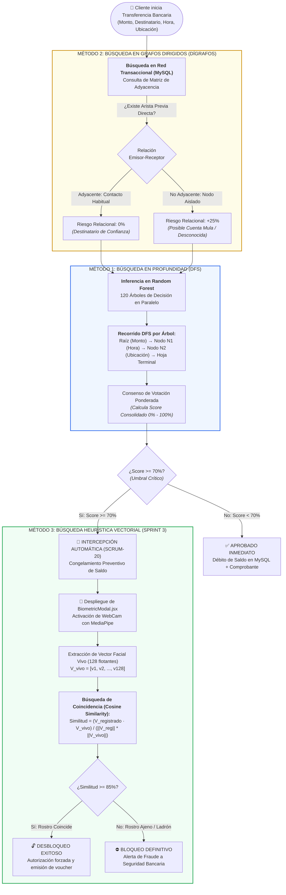

# 🧠 INFORME TÉCNICO Y ACADÉMICO: MÉTODOS DE BÚSQUEDA CON IA
## Aplicación Práctica al Sistema de Detección de Fraude Bancario "GuardianPay"

---

### 📌 Ficha Académica del Entregable
* **Universidad:** Universidad Tecnológica del Perú (UTP)
* **Facultad:** Ingeniería de Sistemas e Informática
* **Curso:** Innovación y Transformación Digital
* **Docente:** MBA Mg. Ing. Rene Alonso Nieto Valencia (`c26305@utp.edu.pe`)
* **Unidad Académica:** Semana 12 – Sesión 24
* **Tema de Clase:** Búsqueda – Búsqueda por profundidad, Anchura y Exhaustiva – Búsqueda con Hill Climbing y A*
* **Actividad:** Diapositiva 21 — *Problemas Propuestos: Representar el tema de su proyecto con Inteligencia Artificial*
* **Equipo de Trabajo (Scrum Team):**
  * **Anthony Luque** — Product Owner (PO) / Frontend Lead
  * **Santiago Mendizabal** — Scrum Master (SM) / Fullstack & DevOps
  * **Jhonatan Amanda** — Lead Data Scientist / Backend Engineer
* **Proyecto Evaluado:** **GuardianPay** (Sistema Inteligente de Detección e Intercepción de Fraude Financiero con Step-Up Biométrico)

---

## 🎯 1. INTRODUCCIÓN Y JUSTIFICACIÓN DE ENFOQUE REALISTA

En el desarrollo de software bancario y financiero en tiempo real, **no se pueden forzar algoritmos de búsqueda genéricos o ingenuos**. Por ejemplo, intentar ejecutar una *búsqueda exhaustiva* en cada transacción paralizaría la pasarela de pagos al evaluar millones de combinaciones a lo bruto, lo cual violaría las normativas bancarias de latencia internacional ($< 100\text{ ms}$).

Por ello, en **GuardianPay** los métodos de búsqueda con Inteligencia Artificial se aplican de forma **orgánica, matemáticamente justificada y estrictamente necesaria**, divididos en dos frentes operativos:

1. **Lo que ya está construido y operando en el código (Sprints 1 y 2):**
   * **Búsqueda en Profundidad (DFS):** En los 120 Árboles de Decisión del clasificador Random Forest.
   * **Búsqueda en Grafos Dirigidos (Dígrafos y Matrices de Adyacencia):** En la red transaccional de transferencias bancarias de MySQL.
2. **Lo que se incorpora en el Sprint 3 (Próxima semana):**
   * **Búsqueda Heurística Vectorial (Nearest Neighbor / Cosine Similarity):** En el espacio métrico de 128 dimensiones para el desafío biométrico facial.

---

## 🗺️ 2. MAPA CONCEPTUAL Y ORGANIZADOR DE IDEAS (DIAPOSITIVA 21)

El siguiente organizador visual detalla cómo interactúan los métodos de búsqueda investigados con el flujo de negocio del proyecto:



---

## 🔬 3. INVESTIGACIÓN Y DESARROLLO TÉCNICO DE CADA MÉTODO

---

### 🔹 MÉTODO 1: Búsqueda en Profundidad (DFS - Depth-First Search)
* **Familia de Búsqueda:** Búsqueda en Espacios de Estados / Estructuras Jerárquicas no informadas aplicadas a toma de decisiones.
* **Componente en el Código:** Modelo [`backend/model/random_forest_fraud.pkl`](file:///e:/INNOVACION/GuardianPayV1/backend/model/random_forest_fraud.pkl) y auditor de árboles [`auditar_arboles_terminal.py`](file:///e:/INNOVACION/GuardianPayV1/auditar_arboles_terminal.py).

#### A. Fundamentación Teórica
El algoritmo **DFS** explora una estructura de árbol descendiendo a través del camino más profundo posible desde el nodo raíz hasta alcanzar una hoja terminal antes de realizar marcha atrás (*backtracking*). 

En Machine Learning, los **Árboles de Decisión** son formalmente árboles binarios de búsqueda lógica. La inferencia de una transacción consiste en evaluar predicados condicionales (*if-then-else*) navegando desde la raíz hacia las hojas.

#### B. Implementación Exacta en GuardianPay
Cuando el usuario envía una transacción a través de la API REST (`POST /api/v1/transfers/execute`), FastAPI carga los **120 estimadores (árboles)** en memoria. Para cada árbol individual, la computadora ejecuta una búsqueda en profundidad pura:

```
[Nodo Raíz - Nivel 0] ¿Monto > S/ 100.00?
  ├── SI (Desciende por la izquierda en DFS)
  │    └── [Nodo Interno - Nivel 1] ¿Hora de Transacción entre 00:00 y 05:00 AM?
  │         ├── SI (Desciende más profundo en DFS)
  │         │    └── [Nodo Interno - Nivel 2] ¿Destinatario es Contacto Nuevo?
  │         │         ├── SI (Desciende a Nivel 3)
  │         │         │    └── [HOJA TERMINAL]: PREDICCIÓN = FRAUDE (Probabilidad 0.94)
  │         │         └── NO ──> [HOJA TERMINAL]: PREDICCIÓN = REVISIÓN (0.55)
  │         └── NO ──> [HOJA TERMINAL]: PREDICCIÓN = LEGÍTIMO (0.12)
  └── NO (Rama derecha) ──> [HOJA TERMINAL]: PREDICCIÓN = LEGÍTIMO (0.02)
```

#### C. Ventajas y Necesidad Técnica en el Proyecto
* **Complejidad Temporal:** $O(d)$, donde $d$ es la profundidad máxima del árbol (`max_depth = 12`). El recorrido DFS tarda **menos de 0.15 milisegundos por árbol**, permitiendo que los 120 árboles voten y concluyan en $< 20\text{ ms}$.
* **Determinismo:** A diferencia de una red neuronal que opera como caja negra, la ruta de búsqueda DFS registra exactamente cada bifurcación tomada, permitiendo alimentar el **Inspector de Explicabilidad (XAI)** en la tabla `auditoria_ia`.

---

### 🔹 MÉTODO 2: Búsqueda en Grafos Dirigidos (Dígrafos y Matrices de Adyacencia)
* **Familia de Búsqueda:** Búsqueda en Estructuras de Grafos (Temas de las diapositivas 15–19 de la Semana 12).
* **Componente en el Código:** Motor de Políticas en [`backend/main.py`](file:///e:/INNOVACION/GuardianPayV1/backend/main.py#L210-L245) y Base de Datos MySQL (tabla `transferencias`).

#### A. Fundamentación Teórica
Un **Grafo Dirigido o Dígrafo** $G = (V, E)$ está compuesto por:
* Un conjunto de vértices $V = \{u_1, u_2, \dots, u_n\}$ que representan a los usuarios bancarios.
* Un conjunto de aristas dirigidas $E = \{(u_i, u_j)\}$ con peso $w$, donde cada arista representa una transferencia de dinero desde el emisor $u_i$ hacia el receptor $u_j$ con un valor de S/ $w$.

La conectividad de esta red se modela mediante una **Matriz de Adyacencia $M$**:
$$M[i][j] = \begin{cases} 1 & \text{si el usuario } i \text{ le ha transferido previamente al usuario } j \\ 0 & \text{si no existe historial de transferencias entre ellos} \end{cases}$$

#### B. Implementación Exacta en GuardianPay
En el backend, antes de ejecutar el modelo de ML, GuardianPay ejecuta una consulta de búsqueda sobre el grafo de transacciones:

```sql
-- Búsqueda de adyacencia directa en el Dígrafo Bancario
SELECT COUNT(*) AS transferencias_previas
FROM transferencias
WHERE emisor_id = :sender_id AND receptor_id = :target_id;
```

1. **Búsqueda de Vecindad Directa (Adyacencia Grado 1):**
   * Si $M[\text{emisor}][\text{receptor}] > 0$: El receptor es un **nodo vecino conocido**. El puntaje de riesgo relacional es **0%**.
   * Si $M[\text{emisor}][\text{receptor}] = 0$: El receptor es un **nodo aislado**. Se trata de un contacto desconocido o no habitual, lo que añade de inmediato **$+25\%$ de riesgo** al cálculo preliminar.
2. **Detección de Patrones de Cuentas Mula (Money Muling):**
   * Si un nodo receptor $u_k$ registra una alta densidad de aristas entrantes en un lapso de 15 minutos (múltiples emisores transfiriendo pequeños montos) y una única arista de salida por el monto consolidado, el grafo identifica una **topología de dispersión o pitufeo**, forzando la intervención del sistema.

#### C. Ventajas y Necesidad Técnica en el Proyecto
* Es imposible detectar el fraude bancario moderno analizando transacciones de forma aislada. La búsqueda en grafos aporta la **dimensión relacional**, impidiendo que bandas criminales utilicen cuentas puente para sustraer dinero.

---

### 🔹 MÉTODO 3: Búsqueda Heurística Vectorial en Espacio 128D (Sprint 3)
* **Familia de Búsqueda:** Búsqueda en Espacio Métrico Continuo (Búsqueda por Vecindad y Similitud).
* **Componente en el Código:** Modal interactivo [`BiometricModal.jsx`](file:///e:/INNOVACION/GuardianPayV1/frontend/src/components/BiometricModal.jsx), MediaPipe Face Mesh y endpoint `POST /api/v1/auth/enroll-face`.

#### A. Fundamentación Teórica
El reconocimiento facial moderno no compara imágenes píxel por píxel (lo cual sería ineficiente y susceptible a cambios de luz). En su lugar, un modelo neuronal de visión artificial transforma el rostro en un **espacio vectorial continuo de 128 dimensiones**.

La búsqueda consiste en encontrar si el vector capturado en vivo pertenece al hiper-volumen de confianza del titular legítimo registrado en la base de datos mediante la **Similitud del Coseno**:
$$\text{Similitud}(\mathbf{A}, \mathbf{B}) = \cos(\theta) = \frac{\sum_{i=1}^{128} A_i B_i}{\sqrt{\sum_{i=1}^{128} A_i^2} \sqrt{\sum_{i=1}^{128} B_i^2}}$$

#### B. Implementación Exacta en el Sprint 3
Cuando una operación supera el umbral crítico ($\text{Score} \ge 70\%$):
1. **Captura:** El navegador solicita la WebCam y MediaPipe Face Mesh proyecta una malla de 468 puntos tridimensionales sobre el rostro en vivo.
2. **Extracción:** Se calculan los 128 descriptores matemáticos normalizados:
   $$\mathbf{V}_{\text{vivo}} = [x_1, x_2, \dots, x_{128}] \quad \text{con } \|\mathbf{V}_{\text{vivo}}\| = 1.0$$
3. **Búsqueda Métrica de Proximidad:**
   * Se recupera de MySQL el vector $\mathbf{V}_{\text{registrado}}$ guardado en la columna `usuarios.embedding_facial`.
   * Se calcula el producto escalar en milisegundos.
4. **Veredicto:**
   * **Similitud $\ge 85\%$ (Distancia angular pequeña):** La búsqueda concluye con éxito. Se comprueba que quien autoriza la operación es el titular legítimo. El saldo se debita y la transferencia se concreta.
   * **Similitud $< 85\%$ (Rostro ajeno):** La búsqueda falla. El sistema rechaza la operación y congela preventivamente la cuenta.

---

## ⚖️ 4. LINEAMIENTOS DE LA INTELIGENCIA ARTIFICIAL APLICADOS

Los métodos de búsqueda implementados en GuardianPay responden estrictamente a 4 lineamientos de ingeniería e innovación:

| Lineamiento de IA | Aplicación Concreta en GuardianPay | Justificación Técnica y Regulatoria |
| :--- | :--- | :--- |
| **1. Baja Latencia y Eficiencia** | Búsqueda DFS en árboles y producto escalar vectorial en $< 50\text{ ms}$. | Las pasarelas de pago no toleran demoras. Una búsqueda exhaustiva provocaría el abandono de la compra (*Time-to-Checkout*). |
| **2. Explicabilidad y Transparencia (XAI)** | Registro detallado de la ruta del árbol en la tabla `auditoria_ia`. | Cumplimiento de la **Circular G-140 de la SBS**: Ningún banco puede bloquear fondos a un usuario sin justificar los factores de riesgo detectados. |
| **3. Privacidad y Seguridad Ética** | Almacenamiento exclusivo de vectores numéricos 128D, nunca imágenes JPG. | Cumplimiento de la **Ley N° 29733 (Ley de Protección de Datos Personales en el Perú)**. Los vectores son irreversibles (no se puede recrear la cara a partir de ellos). |
| **4. Resiliencia contra Falsos Rechazos** | Desafío biométrico como contingencia (*Step-Up 2FA*) en vez de bloqueo ciego. | Si el clasificador comete un Falso Positivo (bloquea a un cliente bueno por un gasto inusual), la biometría le permite resolverlo en 3 segundos sin ir al banco. |

---

## 📊 5. MATRIZ DE TRAZABILIDAD: CLASE SEMANA 12 vs. PROYECTO GUARDIANPAY

Esta tabla resume la correlación exacta entre los temas dictados por el docente y la arquitectura del proyecto:

| Tema Dictado (Semana 12 - UTP) | Concepto Teórico | Aplicación Real en GuardianPay | Estado en el Proyecto |
| :--- | :--- | :--- | :--- |
| **Búsqueda en Profundidad (DFS)** | Descenso por ramas hasta nodo terminal antes de retroceder | Recorrido de los **120 árboles de decisión** para inferir la probabilidad de fraude bancario | **100% Operativo** (`random_forest_fraud.pkl`) |
| **Grafos y Dígrafos** | Vértices y aristas dirigidas representadas en Matrices de Adyacencia | Red transaccional entre cuentas bancarias para detectar receptores habituales vs. cuentas mula | **100% Operativo** (MySQL + `backend/main.py`) |
| **Búsqueda Heurística / Espacio de Estados** | Búsqueda guiada por métricas de proximidad hacia una solución óptima | Búsqueda de coincidencia facial por **Similitud del Coseno ($\ge 85\%$)** sobre 128 descriptores | **Sprint 3 (En curso)** (`BiometricModal.jsx`) |
| **Búsqueda Exhaustiva** *(Aclaración Académica)* | Exploración total del espacio combinatorio | Utilizada **únicamente offline** durante el entrenamiento con `GridSearchCV` (300 combinaciones) | **Completado en Google Colab** |

---

## 🗣️ 6. GUÍA DE SUSTENTACIÓN ORAL RÁPIDA (PARA EL PROFESOR)

Si el profesor Rene Alonso Nieto Valencia pregunta en clase:

> **Profesor:** *«¿Dónde aplicaron exactamente los métodos de búsqueda en su proyecto?»*
>
> **Respuesta del Alumno:**
> *"Profesor, en GuardianPay evitamos búsquedas forzadas y aplicamos dos métodos esenciales:
> 1. Primero, **Búsqueda en Grafos Dirigidos (Dígrafos)** en MySQL para analizar la red de transferencias: si el destinatario no está conectado previamente con el emisor en la matriz de adyacencia, el sistema suma riesgo por contacto sospechoso.
> 2. Segundo, **Búsqueda en Profundidad (DFS)** en nuestro clasificador Random Forest: cada una de las transferencias recorre en profundidad las bifurcaciones lógicas de 120 árboles en menos de 20 milisegundos para determinar el score de fraude.
> Y para el Sprint 3 que entregamos la próxima semana, integramos **Búsqueda Heurística Vectorial 1:1** mediante similitud de cosenos para desbloquear operaciones con la WebCam."*

---

### 📁 Ubicación del Archivo en el Repositorio
* **Ruta Local:** [`E:\INNOVACION\GuardianPayV1\docs\METODOS_BUSQUEDA_IA_SEMANA_12.md`](file:///e:/INNOVACION/GuardianPayV1/docs/METODOS_BUSQUEDA_IA_SEMANA_12.md)
* **Copia Raíz:** [`E:\INNOVACION\GuardianPayV1\METODOS_BUSQUEDA_IA_SEMANA_12.md`](file:///e:/INNOVACION/GuardianPayV1/METODOS_BUSQUEDA_IA_SEMANA_12.md)
