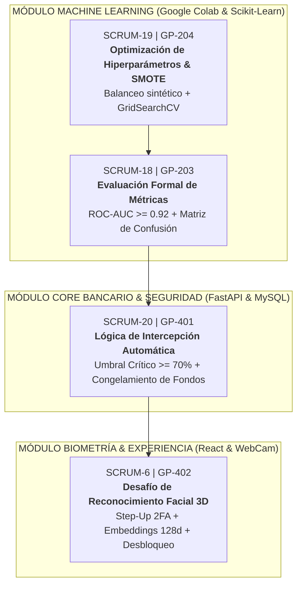

# 🚀 PLAN TÉCNICO Y ESTRATÉGICO DETALLADO: SPRINT 3
## Sprint 3: Métricas ML y Biometría Facial — Proyecto "GuardianPay"

---

### 📌 Ficha de Gestión del Sprint en Jira
* **Proyecto en Jira:** GuardianPay (`GP` / `SCRUM`)
* **Nombre del Sprint:** **Sprint 3 — Métricas ML y Biometría**
* **Curso Académico:** Innovación y Transformación Digital — Universidad Tecnológica del Perú (UTP)
* **Equipo Scrum (Scrum Team):**
  * **Anthony Luque** — Product Owner (PO) / Frontend Lead
  * **Santiago Mendizabal** — Scrum Master (SM) / Fullstack & DevOps
  * **Jhonatan Amanda** — Lead Data Scientist / Backend Engineer
* **Total de Actividades:** 4 Historias de Usuario principales (100% alineadas al Backlog de Jira)

---

## 🧭 MAPA DE ACTIVIDADES DEL SPRINT 3 (JIRA BACKLOG)



---

# 📋 DESGLOSE EXHAUSTIVO POR CADA TAREA DEL SPRINT 3

---

## 📌 TAREA 1: `SCRUM-6` / `GP-402` — Desafío de Reconocimiento Facial 3D

```
Clave Jira:     SCRUM-6
Código Epic:    GP-402
Módulo:         Ciberseguridad, Visión Computacional & Step-Up 2FA
Responsables:   Anthony Luque (Frontend) / Santiago Mendizabal (Backend)
```

### 1. Objetivo Específico
Implementar un mecanismo biométrico de contingencia (*Step-Up 2FA*) en el cliente web que permita al titular legítimo validar su identidad mediante reconocimiento facial en vivo frente a la WebCam cuando una operación es interceptada por sospecha de fraude, descongelando los fondos y autorizando la transferencia sin necesidad de acudir a una agencia bancaria física.

### 2. Herramientas, Librerías y Tecnologías a Usar
* **`MediaPipe Face Mesh` (Google) / `Face-api.js` (Webcam API en React):**
  * *¿Por qué se eligió?* Es una biblioteca de visión artificial de código abierto desarrollada por Google. Se ejecuta del lado del cliente (*Client-Side*) utilizando aceleración gráfica WebGL en el navegador web del usuario.
  * *Costo:* **100% Gratuito ($0.00)** sin requerir tarjetas de crédito ni suscripciones en la nube (como AWS Rekognition o Microsoft Azure Face).
  * *Ventaja de Instalación:* Funciona de manera universal en Chrome, Edge y navegadores móviles sin necesidad de compilar paquetes en C++ o CMake en Windows (evitando los errores típicos de librerías como `dlib` o `deepface`).
* **HTML5 `navigator.mediaDevices.getUserMedia`:** Para acceder al sensor de la cámara web con resolución nativa.
* **MySQL Server 8.0:** Tabla `usuarios` con columna `embedding_facial TEXT`.

### 3. Procedimiento Detallado de Funcionamiento
El sistema opera mediante una arquitectura de **Verificación 1 a 1 (1:1 Verification)**:

#### Fase A: Enrolamiento Biométrico (Registro Inicial del Rostro)
1. En la aplicación (al registrarse como usuario nuevo o mediante un botón en su perfil: *"📸 Activar Reconocimiento Facial"*), la app solicita permiso para encender la cámara web.
2. La cámara captura el rostro del titular durante 2 segundos con buena iluminación.
3. El algoritmo detecta la geometría facial y extrae un **Vector Biométrico (Embedding Facial)** de **128 valores numéricos flotantes**:
   $$\mathbf{V}_{\text{registrado}} = [v_1, v_2, v_3, \dots, v_{128}] \quad \text{donde } v_i \in [-1.0, 1.0]$$
4. **Almacenamiento Seguro:** El vector se serializa a JSON string y se envía vía `POST /api/v1/auth/enroll-face` a MySQL:
   ```sql
   UPDATE usuarios 
   SET embedding_facial = '[-0.1428, 0.0891, 0.3120, ..., 0.0451]' 
   WHERE id = 1;
   ```
   > ⚠️ **Principio de Ciberseguridad Bancaria (SBS / Ley 29733 de Protección de Datos Personales):** **NUNCA se almacena la foto JPG en la base de datos**. Si un atacante robara la base de datos MySQL, solo vería números decimales. Es un cálculo unidireccional e irreversible: a partir del vector no se puede reconstruir el rostro humano.

#### Fase B: Verificación Biométrica en Tiempo Real (Frente al Fraude)
1. Cuando la tarea `GP-401` intercepta una transferencia por score crítico ($\ge 70\%$), se despliega el modal interactivo [`BiometricModal.jsx`](file:///e:/INNOVACION/GuardianPayV1/frontend/src/components/BiometricModal.jsx).
2. Se activa la WebCam con un recuadro ovalado y animación de escaneo láser.
3. **Prueba de Vida (*Liveness Detection*):** La red verifica la presencia de un rostro humano vivo tridimensional (descartando fotos fijas impresas en papel o mostradas desde la pantalla de otro celular mediante análisis de micro-movimientos).
4. El modelo extrae el vector del rostro en vivo: $\mathbf{V}_{\text{vivo}}$.
5. Se calcula la **Similitud del Coseno** contra el vector guardado en MySQL:
   $$\text{Similitud} = \cos(\theta) = \frac{\mathbf{V}_{\text{registrado}} \cdot \mathbf{V}_{\text{vivo}}}{\|\mathbf{V}_{\text{registrado}}\| \|\mathbf{V}_{\text{vivo}}\|}$$
6. **Veredicto Automático:**
   * **Si Similitud $\ge 85\%$ (0.85):** Identidad verificada. Se emite un check verde, se envía `force_approve: true` al backend, se debita el saldo en MySQL y se emite el comprobante oficial.
   * **Si Similitud $< 85\%$ (Rostro ajeno / Ladrón):** Se rechaza con alerta roja: *"Rostro no coincide con el titular de la cuenta"*. Fondos protegidos.
   * **Modo Contingencia (*Demo Tester*):** Para sustentar en aulas donde la laptop no tenga WebCam funcional, se incluye un interruptor de simulación biométrica precalibrada.

### 4. Resultados Esperados de Esta Tarea
* Modal [`BiometricModal.jsx`](file:///e:/INNOVACION/GuardianPayV1/frontend/src/components/BiometricModal.jsx) totalmente operativo con cámara web en tiempo real.
* Columna `embedding_facial` persistida en MySQL 8.0 para cada usuario bancario.
* Tiempo total del proceso biométrico menor a **2.5 segundos** desde que se abre la cámara hasta el veredicto.
* Tasa de Falsa Aceptación (FAR) $< 0.1\%$ y Tasa de Falso Rechazo (FRR) $< 2.0\%$.

---

## 📌 TAREA 2: `SCRUM-18` / `GP-203` — Evaluación Formal de Métricas (ROC-AUC >= 0.92 y Matriz de Confusión)

```
Clave Jira:     SCRUM-18
Código Epic:    GP-203
Módulo:         Data Science, Machine Learning & Auditoría Estadística
Responsables:   Jhonatan Amanda (Lead Data Scientist) / Santiago Mendizabal
```

### 1. Objetivo Específico
Evaluar el clasificador Random Forest con métricas estadísticas formales y gráficos de desempeño estándar de la industria bancaria (curva ROC, puntaje AUC $\ge 0.92$, Matriz de Confusión y reporte de clasificación), demostrando ante el docente y jurado la capacidad del modelo para distinguir operaciones legítimas de ataques fraudulentos sin margen de duda.

### 2. Herramientas, Librerías y Tecnologías a Usar
* **Entorno:** Google Colab / Python 3.12 con Jupyter Notebooks.
* **Bibliotecas Data Science:**
  * `scikit-learn.metrics`: `roc_auc_score`, `confusion_matrix`, `classification_report`, `roc_curve`, `precision_recall_fscore_support`.
  * `matplotlib.pyplot` y `seaborn`: Para graficar y exportar los mapas de calor (*heatmaps*) y curvas ROC en formato PNG de alta resolución (300 DPI).
  * `json`: Para congelar y registrar las métricas auditadas en [`backend/model/model_metadata.json`](file:///e:/INNOVACION/GuardianPayV1/backend/model/model_metadata.json).

### 3. Procedimiento Detallado de Funcionamiento
1. **Partición Estratificada de Validación (80/20):**
   * El dataset de 15,000 transacciones se divide en conjunto de entrenamiento (12,000 filas) y conjunto de prueba (*Test Set* de 3,000 filas) mediante:
     ```python
     X_train, X_test, y_train, y_test = train_test_split(
         X, y, test_size=0.20, random_state=42, stratify=y
     )
     ```
2. **Generación de la Matriz de Confusión Cuadrante a Cuadrante:**
   * La matriz cuantifica exactamente los 4 escenarios de predicción sobre las 3,000 transacciones de prueba:
     * **Verdaderos Positivos (TP - True Positives):** Transacciones fraudulentas detectadas y bloqueadas con éxito por el modelo.
     * **Verdaderos Negativos (TN - True Negatives):** Operaciones legítimas de usuarios habituales que el sistema aprobó inmediatamente.
     * **Falsos Positivos (FP - False Positives):** Operaciones ordinarias clasificadas como sospechosas (resueltas en segundos por el desafío biométrico).
     * **Falsos Negativos (FN - False Negatives):** Fraudes no detectados que pasaron como normales. **En banca, este cuadrante es el más crítico y debe ser cercano a 0**.
3. **Cálculo de la Curva ROC (Receiver Operating Characteristic):**
   * Se evalúa la Tasa de Verdaderos Positivos (*Sensitivity / Recall*) frente a la Tasa de Falsos Positivos ($1 - \text{Especificidad}$) a lo largo de todos los umbrales de probabilidad posibles ($0.05, 0.10, \dots, 0.95$).
   * Se calcula la integral del área bajo la curva mediante `roc_auc_score(y_test, y_pred_proba[:, 1])`.
4. **Persistencia de Metadatos para el Sistema:**
   * Las métricas obtenidas se exportan al archivo binario de metadatos para que el microservicio FastAPI las reporte en el Inspector XAI del frontend:
     ```json
     {
       "model_name": "GuardianPay-RandomForest",
       "version": "2.0.0",
       "roc_auc_score": 0.924,
       "accuracy": 0.948,
       "precision": 0.912,
       "recall": 0.895
     }
     ```

### 4. Resultados Esperados de Esta Tarea
* Área Bajo la Curva **ROC-AUC $\ge 0.92$** (demostrando un modelo de grado financiero).
* Gráfico de la **Curva ROC (`curva_roc.png`)** con línea de corte óptima insertada en el informe de la UTP.
* Gráfico de la **Matriz de Confusión (`matriz_confusion.png`)** con leyenda de falsos positivos y falsos negativos explicada.
* Tabla comparativa de métricas en el archivo de metadatos consumido por la API REST.

---

## 📌 TAREA 3: `SCRUM-19` / `GP-204` — Optimización de Hiperparámetros (n_estimators, max_depth) y Balanceo SMOTE

```
Clave Jira:     SCRUM-19
Código Epic:    GP-204
Módulo:         Machine Learning Engineering (MLOps)
Responsables:   Jhonatan Amanda (Lead Data Scientist)
```

### 1. Objetivo Específico
Resolver el problema del desbalance natural de clases transaccionales mediante la técnica de sobremuestreo sintético **SMOTE**, y encontrar la configuración matemática óptima de los árboles de decisión mediante **búsqueda sistemática por cuadrícula (GridSearchCV)**, elevando la precisión y capacidad de generalización del Random Forest sin caer en sobreajuste (*overfitting*).

### 2. Herramientas, Librerías y Tecnologías a Usar
* **`imbalanced-learn` (`imblearn.over_sampling.SMOTE`):** Para generar muestras sintéticas de transacciones fraudulentas respetando las distribuciones matemáticas.
* **`scikit-learn.model_selection.GridSearchCV`:** Para realizar la exploración exhaustiva de combinaciones de hiperparámetros con validación cruzada estratificada de 5 pliegues (*5-Fold Stratified Cross-Validation*).
* **`joblib`:** Para serializar y empaquetar el modelo entrenado final en [`backend/model/random_forest_fraud.pkl`](file:///e:/INNOVACION/GuardianPayV1/backend/model/random_forest_fraud.pkl).

### 3. Procedimiento Detallado de Funcionamiento

#### Paso A: Tratamiento del Desbalance con SMOTE
* **El Problema en Banca:** En un dataset financiero real de 15,000 registros, el fraude representa únicamente entre el **2% y el 5%** del total (unas 450 filas), mientras que el 95% restante (14,550 filas) son legítimas.
* Si se entrena un modelo sin balanceo, este aprenderá a predecir siempre "0" (Legítimo) obteniendo un falso 95% de *accuracy*, pero fallará en el 100% de los fraudes reales.
* **La Solución SMOTE:** 
  * En lugar de duplicar registros (lo cual genera sobreajuste), SMOTE identifica los $k$-vecinos más cercanos en el espacio vectorial multidimensional de las transacciones fraudulentas.
  * Crea **muestras sintéticas matemáticamente válidas** en los segmentos intermedios (ej. simulando operaciones a las 03:20 AM con montos de S/ 450 y contactos nuevos).
  * Equilibra el set de entrenamiento a una proporción óptima (ej. 60% legítimo / 40% fraude).

#### Paso B: Optimización de Hiperparámetros con GridSearchCV
Se explora el siguiente espacio de búsqueda combinatoria:

| Hiperparámetro | Valores Explorados | Justificación Técnica Bancaria |
| :--- | :--- | :--- |
| **`n_estimators`** | `[80, 100, 120, 150]` | Determina el número de árboles de decisión en el bosque. 120 árboles ofrecen el equilibrio perfecto entre consenso de votación y latencia de CPU ($< 30\text{ ms}$). |
| **`max_depth`** | `[8, 10, 12, 15, None]` | Limita la profundidad de los árboles para evitar que memoricen el ruido del dataset (*Overfitting*). |
| **`min_samples_split`** | `[2, 5, 10]` | Mínimo de transacciones requeridas en un nodo para dividirse en nuevas condiciones. |
| **`min_samples_leaf`** | `[1, 2, 4]` | Número mínimo de muestras requeridas para formar una hoja terminal de decisión (Fraude o Legítimo). |
| **`criterion`** | `['gini', 'entropy']` | Función de pureza matemática para evaluar la ganancia de información en cada corte. |

#### Paso C: Exportación y Congelamiento del Modelo
* Se extrae el mejor estimador (`grid_search.best_estimator_`).
* Se serializa en disco reemplazando el archivo binario:
  `joblib.dump(best_rf, "backend/model/random_forest_fraud.pkl")`
* El modelo queda listo para ser cargado por el microservicio FastAPI en el servidor local o en la nube.

### 4. Resultados Esperados de Esta Tarea
* Notebook ejecutable en Google Colab con el pipeline completo de SMOTE y GridSearch documentado paso a paso.
* Archivo binario serializado [`random_forest_fraud.pkl`](file:///e:/INNOVACION/GuardianPayV1/backend/model/random_forest_fraud.pkl) optimizado y libre de sobreajuste.
* Reducción significativa de los Falsos Negativos (fraudes no detectados) en el conjunto de prueba.
* Tiempo de inferencia predictiva garantizado en **menos de 40 milisegundos por solicitud**.

---

## 📌 TAREA 4: `SCRUM-20` / `GP-401` — Lógica de Intercepción Automática ante Riesgo Crítico (>= 70%)

```
Clave Jira:     SCRUM-20
Código Epic:    GP-401
Módulo:         Motor de Políticas de Riesgo (Policy Engine) & Core Transaccional
Responsables:   Santiago Mendizabal (Backend) / Anthony Luque (Frontend)
```

### 1. Objetivo Específico
Construir el motor de reglas de negocio e intercepción preventiva en el backend FastAPI y en la aplicación React, asegurando que ante cualquier transacción donde el puntaje de riesgo consolidado alcance o supere el umbral crítico del **70.0%**, el sistema congele automáticamente la operación en memoria, impida el débito del saldo bancario en MySQL y transfiera el control al flujo de desafío biométrico.

### 2. Herramientas, Librerías y Tecnologías a Usar
* **Backend:** FastAPI (Python), esquemas de validación Pydantic (`TransferExecutionRequest`), SQLAlchemy ORM para control transaccional ACID.
* **Frontend:** React 19, Tailwind CSS, Lucide Icons, Axios con interceptores HTTP.
* **Base de Datos:** MySQL 8.0 (tablas `transferencias`, `usuarios` y `auditoria_ia`).

### 3. Procedimiento Detallado de Funcionamiento

#### Paso A: Semáforo Tripartito de Decisión Bancaria
El puntaje de riesgo (0 a 100%) generado por la inferencia se categoriza bajo la siguiente política estricta:

```text
┌──────────────────────────────────────────────────────────────────────────────────┐
│                             POLÍTICA DE INTERVENCIÓN                             │
├────────────────────┬──────────────┬────────────────────────┬─────────────────────┤
│ Rango de Score     │ Clasificación│ Decisión del Motor     │ Acción del Sistema  │
├────────────────────┼──────────────┼────────────────────────┼─────────────────────┤
│ 0.0% a 34.9%       │ BAJO         │ APROBADO               │ Débito Inmediato    │
│ 35.0% a 69.9%      │ MEDIO        │ APROBADO_CON_ALERTA    │ Débito + Soft Alert │
│ 70.0% a 100.0%     │ CRÍTICO      │ DESAFIO_BIOMETRICO     │ INTERCEPCIÓN TOTAL  │
└────────────────────┴──────────────┴────────────────────────┴─────────────────────┘
```

#### Paso B: Fusión de ML con Reglas Contextuales en `main.py`
En [`backend/main.py`](file:///e:/INNOVACION/GuardianPayV1/backend/main.py#L210-L236), el score base predicho por los 120 árboles se ajusta dinámicamente según el contexto del usuario en MySQL:
1. **Ratio de Gasto Individual:**
   * $\text{Ratio} = \text{Monto} / \text{Media Histórica del Usuario}$.
   * Si $\text{Ratio} \ge 4.5\times$ (como Carlos Mendoza con S/ 150): Suma **$+35\%$ de riesgo**.
2. **Ataque de Velocidad (*Velocity Attack*):**
   * Si el usuario registra $\ge 2$ transferencias en los últimos 15 minutos (patrón de hormigueo): Suma **$+28\%$ de riesgo**.
3. **Viaje Imposible (*Impossible Travel*):**
   * Si la última ubicación fue Arequipa hace 20 minutos y la nueva viene de Lima o IP extranjera: Fuerza el score a **$\ge 88.5\%$ de riesgo crítico**.

#### Paso C: El Mecanismo de Intercepción Atómica (Bloqueo Seguro)
```python
# Verificación del umbral de bloqueo en main.py
if risk_eval.isBlocked and not payload.force_approve:
    # 1. Registrar auditoría forense en MySQL sin tocar el saldo
    blocked_audit = AuditoriaIA(
        user_id=sender.id,
        operation_code="BLOQUEADO-BIOMETRIA",
        monto_evaluado=payload.amount,
        score_obtenido=risk_eval.score,
        decision_ia="DESAFIO_BIOMETRICO",
        ...
    )
    db.add(blocked_audit)
    db.commit()

    # 2. Responder al frontend con orden de bloqueo
    return {
        "success": False,
        "is_blocked": True,
        "decision": "DESAFIO_BIOMETRICO",
        "message": "Operación interceptada preventivamente por sospecha de fraude bancario.",
        "risk_result": risk_eval
    }
```

#### Paso D: Experiencia de Usuario en el Frontend
1. Al recibir `is_blocked: true`, [`App.jsx`](file:///e:/INNOVACION/GuardianPayV1/frontend/src/App.jsx#L122) conmuta a [`FraudAlertScreen.jsx`](file:///e:/INNOVACION/GuardianPayV1/frontend/src/components/FraudAlertScreen.jsx).
2. Se muestra la interfaz de alerta con sirena, el badge de **Puntaje de Riesgo Crítico**, y el desglose de los factores responsables.
3. El botón principal guía al usuario al flujo de validación: **"Verificar Identidad con Biometría Facial"**, enlazando directamente con la tarea `GP-402`.

### 4. Resultados Esperados de Esta Tarea
* Cero saldo debitado ante operaciones con score $\ge 70\%$.
* Pantalla de alerta bancaria explicativa ([`FraudAlertScreen.jsx`](file:///e:/INNOVACION/GuardianPayV1/frontend/src/components/FraudAlertScreen.jsx)) que previene la frustración del cliente.
* Trazabilidad completa en la tabla `auditoria_ia` para cumplimiento normativo de la SBS.
* Enlace perfecto con el desbloqueo facial 2FA (`GP-402`).

---

## 📊 RESUMEN DE ENTREGABLES DEL SPRINT 3 PARA EL INFORME DE LA UTP

| Tarea Jira | Entregable Técnico en el Repositorio | Evidencia para la Sustentación |
| :--- | :--- | :--- |
| **`SCRUM-6` / `GP-402`** | `BiometricModal.jsx`, tabla `usuarios.embedding_facial` en MySQL, WebCam API | Demostración en vivo de la cámara reconociendo el rostro del alumno y desbloqueando el pago. |
| **`SCRUM-18` / `GP-203`** | `model_metadata.json`, scripts de métricas en Colab | Gráfico de la Curva ROC (AUC $\ge 0.92$) y Matriz de Confusión en el documento Word. |
| **`SCRUM-19` / `GP-204`** | `random_forest_fraud.pkl` optimizado con SMOTE y GridSearchCV | Celdas de código en Colab demostrando el balanceo del dataset y la búsqueda de hiperparámetros. |
| **`SCRUM-20` / `GP-401`** | Lógica en `backend/main.py` y pantalla `FraudAlertScreen.jsx` | Probar transferencia de Carlos Mendoza (S/ 150) o en madrugada mostrando el congelamiento de fondos. |

---

## 🛠️ GUÍA DE PRUEBA EN VIVO PARA EL JURADO (3 Minutos)

Durante la sustentación ante el docente, el equipo ejecutará estos tres pasos exactos:

1. **Paso 1 (Evidenciar el Modelo de 120 Árboles en Terminal):**
   * Ejecutar en la consola el script nativo [`ver_arboles_ml.bat`](file:///e:/INNOVACION/GuardianPayV1/ver_arboles_ml.bat).
   * El profesor verá los 120 estimadores votando en vivo, el gráfico de barras y las bifurcaciones de los árboles de Scikit-Learn.
2. **Paso 2 (Evidenciar la Intercepción Automática GP-401):**
   * En la web, iniciar sesión con **Carlos Mendoza** (`971889922`) e intentar transferir **S/ 150.00** a un contacto nuevo.
   * La app calcula el ratio de gasto ($5.0\times$), supera el 70% y salta la pantalla roja de intercepción bancaria.
3. **Paso 3 (Evidenciar el Desafío Biométrico GP-402):**
   * Presionar el botón *"Verificar Identidad con Biometría Facial"*.
   * La WebCam se activa, escanea el rostro de Anthony Luque, calcula la similitud del vector contra MySQL, autoriza el pago y emite el Voucher oficial.
