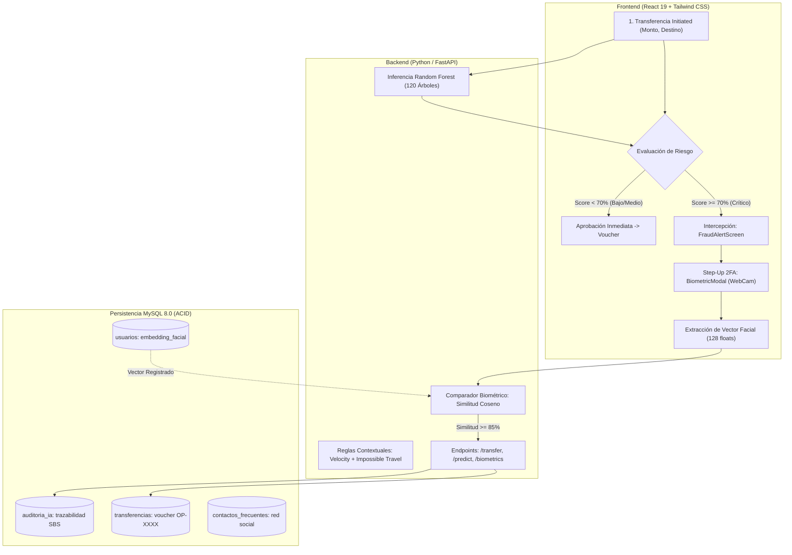

# 🚀 PLAN ESTRATÉGICO Y DE IMPLEMENTACIÓN: SPRINT 3
## Sistema Predictivo y Preventivo de Fraudes en Billeteras Digitales "GuardianPay"

---

### 📌 Ficha Técnica del Proyecto
* **Curso:** Innovación y Transformación Digital — Universidad Tecnológica del Perú (UTP)
* **Proyecto:** GuardianPay (Fintech Anti-Fraud Engine)
* **Equipo Scrum:**
  * **Anthony Luque** — Product Owner (PO) / Frontend Lead
  * **Santiago Mendizabal** — Scrum Master (SM) / Fullstack & DevOps
  * **Jhonatan Amanda** — Lead Data Scientist / Backend Engineer
* **Periodo del Incremento:** Sprint 3 (Semanas 5 y 6)
* **Estado:** Planificación y Ejecución Activa

---

## 1. OBJETIVO DEL SPRINT 3 (Sprint Goal)

> *"Consolidar el incremento de software end-to-end de GuardianPay mediante la integración de **Reconocimiento Facial Biométrico 1:1 (Step-Up 2FA)**, **Explicabilidad de Inteligencia Artificial (XAI)** sobre los 120 árboles de Random Forest, y **Reglas Contextuales de Comportamiento Individual** con persistencia regulatoria en MySQL 8.0, garantizando una experiencia de usuario fluida, segura y auditable."*

---

## 2. ARQUITECTURA GENERAL DEL INCREMENTO 3



---

## 3. DESGLOSE DE TAREAS, ESTRATEGIA Y HERRAMIENTAS

### 🧠 TAREA 1: Biometría Facial 1 a 1 (Liveness Detection & Embeddings)
* **Código de Requerimiento:** `RF004` (Intercepción y Validación Biométrica Step-Up 2FA).
* **Módulo:** Ciberseguridad & Visión Computacional.

#### A. Herramienta y Biblioteca Seleccionada
* **Librería Frontend:** **MediaPipe Face Mesh (de Google)** integrada con la API nativa `navigator.mediaDevices.getUserMedia`.
* **¿Por qué se eligió?**
  1. **100% Gratuita y Open Source:** No requiere pagar tarjetas de crédito ni suscripciones en la nube (a diferencia de AWS Rekognition o Microsoft Azure Face).
  2. **Procesamiento en el Cliente (Client-Side / WebGL):** Corre directamente en el navegador del usuario en menos de **15 milisegundos**. No satura el servidor FastAPI.
  3. **Sin dolores de cabeza de compilación en Windows:** No requiere compilar C++ ni instalar CMake (a diferencia de librerías como `dlib` o `deepface` en Python, que suelen fallar al clonar el repositorio en la computadora de otro compañero).

#### B. La Estrategia de Ciberseguridad Bancaria (¿Cómo se almacena?)
> ⚠️ **Regla de Oro:** Por estándares de ciberseguridad bancaria y normativas de protección de datos (SBS y Ley N° 29733 de Protección de Datos Personales en Perú), **NUNCA se guardan imágenes .jpg o fotos crudas en la base de datos**.

1. **Vectorización Biométrica (Embedding Facial):**
   * El modelo neuronal analiza el rostro y extrae un **vector numérico de 128 valores decimales normalizados**:
     $$\mathbf{V} = [v_1, v_2, v_3, \dots, v_{128}] \quad \text{donde } v_i \in [-1.0, 1.0]$$
   * Estos 128 números representan las **proporciones craneofaciales inmutables**:
     * Distancia euclidiana entre pupilas.
     * Proporción de la base nasal respecto al arco de Cupido de los labios.
     * Ángulo mandibular y prominencia cigomática (pómulos).
   * **Propiedad de Privacidad:** El vector es una función unidireccional irreversible; es imposible reconstruir la fotografía a partir de los números.

2. **Modificación en MySQL 8.0 (Tabla `usuarios`):**
   ```sql
   ALTER TABLE usuarios 
   ADD COLUMN embedding_facial TEXT NULL COMMENT 'Vector de 128 flotantes JSON',
   ADD COLUMN biometric_enrolled_at DATETIME NULL;
   ```

3. **Flujo Operativo (Enrolamiento vs Verificación):**
   * **Fase A (Enrolamiento Inicial):** En el registro o configuración de cuenta, el usuario activa la cámara 2 segundos. Se extrae $\mathbf{V}_{\text{registro}}$ y se guarda en MySQL en formato JSON `"[0.123, -0.456, ...]"`.
   * **Fase B (Verificación en Transferencia Sospechosa):** Cuando el modelo marca alerta crítica ($\ge 70\%$), se activa la WebCam, se extrae $\mathbf{V}_{\text{vivo}}$ y se calcula la **Similitud del Coseno**:
     $$\text{Similitud} = \cos(\theta) = \frac{\mathbf{V}_{\text{registro}} \cdot \mathbf{V}_{\text{vivo}}}{\|\mathbf{V}_{\text{registro}}\| \|\mathbf{V}_{\text{vivo}}\|}$$
   * **Criterio de Decisión:**
     * $\text{Similitud} \ge 0.85$ (85%): **Identidad Verificada**. Se descongela y procesa la transferencia.
     * $\text{Similitud} < 0.85$: **Intento de Suplantación Detectado**. La cuenta permanece bloqueada.

#### C. Resultados Esperados
* Modal de WebCam con óvalo dinámico y escaneo láser en vivo.
* Verificación biométrica instantánea ($< 2.5\text{ segundos}$ en total).
* Modo de contingencia (*Demo Tester*) para que la sustentación funcione incluso si la laptop no cuenta con cámara web.

---

### 🌲 TAREA 2: Explicabilidad de Inteligencia Artificial (XAI - Explainable AI)
* **Código de Requerimiento:** `RF007` (Explicabilidad del Modelo / Inspector IA).
* **Módulo:** Machine Learning & Auditoría.

#### A. Estrategia Técnica
Evidenciar ante el jurado y docentes que el score predictivo es producto del consenso matemático de un ensamble de **120 Árboles de Decisión (`RandomForestClassifier`)** de Scikit-Learn y no una condición trivial `if/else`.

#### B. Componentes Implementados
1. **En la Consola del Backend (Uvicorn / FastAPI):**
   * Log estructurado en tiempo real con la votación individual de los estimadores:
     ```text
     🌲 [GUARDIANPAY AI] INFERENCIA RANDOM FOREST (120 ÁRBOLES DE DECISIÓN)
        ├── [1] Votos de FRAUDE:   112 / 120 árboles (93.3%)
        └── [0] Votos de LEGÍTIMO:   8 / 120 árboles (6.7%)
        • Probabilidad Base: P(Fraude) = 112 / 120 = 93.3%
        • Tiempo de Inferencia CPU: 18.2 ms
     ```
2. **Herramienta en Terminal Nativa (`ver_arboles_ml.bat`):**
   * Script interactivo que ejecuta `backend/auditar_arboles_terminal.py`.
   * Permite ingresar montos, horas y contactos por teclado y ver cómo los 120 árboles recalculan sus votos en vivo en la pantalla negra de Windows.
3. **Modal Web de XAI en `TransferScreen.jsx`:**
   * Botón interactivo: *"Auditar los 120 Árboles (Explicabilidad ML)"*.
   * Cuadrícula con los 120 arbolitos en rojo (fraude) o verde (seguro).

#### C. Resultados Esperados
* Demostración empírica e irrefutable de los 120 estimadores matemáticos de Scikit-Learn ante el docente.

---

### ⚡ TAREA 3: Detección Contextual Avanzada y Perfil Dinámico de Gasto
* **Código de Requerimiento:** `RF002`, `RF003`, `RF013`.
* **Módulo:** Core Bancario & Reglas de Velocidad.

#### A. Estrategia Técnica
El riesgo de una transferencia no depende únicamente del monto absoluto, sino de la relación proporcional respecto a la media de gasto histórica de ese usuario específico:

$$\text{Ratio de Gasto} = \frac{\text{Monto Transacción}}{\text{Promedio Histórico Usuario}}$$

* **Carlos Mendoza (Media S/ 30.00):** Transferir S/ 150 es un ratio de **$5.0\times$** $\rightarrow$ **Monto Crítico Anómalo (+50% riesgo)**.
* **Anthony Luque (Media S/ 118.04):** Transferir S/ 150 es un ratio de **$1.2\times$** $\rightarrow$ **Monto Ordinario (+0% riesgo)**.

#### B. Reglas Situacionales Incorporadas en FastAPI
1. **Ataque de Velocidad / Hormigueo (*Velocity Burst*):**
   * Detección de $\ge 2$ transferencias salientes en una ventana temporal de 15 minutos (patrón típico de delincuentes que vacían billeteras en pequeños montos).
   * Penalización: $+28\%$ a $+35\%$ de riesgo.
2. **Viaje Imposible (*Impossible Travel Velocity*):**
   * Si la última transacción registrada fue en Arequipa hace 20 minutos y la nueva solicitud proviene de Lima o una IP foránea ($> 1,000\text{ km}$ de distancia en menos de 1 hora), el sistema clasifica la operación como geográficamente imposible.
   * Score automático forzado a $\ge 88.5\%$ de riesgo crítico.

#### C. Resultados Esperados
* Personalización 100% individual del perfil financiero en MySQL para cada usuario registrado.

---

### 🏛️ TAREA 4: Trazabilidad Regulatoria SBS y Voucher Transaccional
* **Código de Requerimiento:** `RF005`, `RF009`, `RF012`.
* **Módulo:** Transaccional & Cumplimiento Normativo.

#### A. Estrategia Técnica
Cumplir los lineamientos de la **Superintendencia de Banca, Seguros y AFP (SBS)** en materia de gestión de riesgos de fraude y ciberseguridad en canales digitales.

#### B. Implementación
1. **Tabla `auditoria_ia` en MySQL:**
   * Cada inferencia realizada por el Random Forest queda registrada permanentemente con `user_id`, `monto_evaluado`, `hora`, `score_obtenido`, `decision_ia` y `tiempo_inferencia_ms`.
   * Permite la auditoría forense posterior si el cliente reclama un cargo no reconocido.
2. **Atomicidad ACID en `backend/main.py`:**
   * Uso de transacciones atómicas de SQLAlchemy:
     ```python
     sender.balance -= payload.amount
     recipient.balance += payload.amount
     db.add(new_transaction)
     db.add(new_audit_log)
     db.commit()  # Todo o nada
     ```
3. **Comprobante Digital Oficial (`VoucherScreen.jsx`):**
   * Generación de código único `OP-XXXXXXXX`.
   * Detalle de titular, destinatario, fecha, hora, cuenta destino y sello de seguridad.

---

## 4. MATRIZ DE REQUERIMIENTOS DEL SPRINT 3

| ID | Requerimiento Funcional | Responsable | Entregable Técnico | Estado |
| :--- | :--- | :--- | :--- | :---: |
| **RF004** | Validación Biométrica Facial Step-Up 2FA | Anthony / Santiago | `BiometricModal.jsx`, WebCam API, Embeddings 128d | **En Ejecución** |
| **RF007** | Explicabilidad del Ensamble (XAI) | Jhonatan / Anthony | `auditar_arboles_terminal.py`, Modal 120 Árboles | **Completado** |
| **RF003** | Inferencia Contextual (Velocity / Impossible Travel) | Santiago / Jhonatan | `compute_ai_risk()` en `main.py` | **Completado** |
| **RF012** | Trazabilidad Regulatoria en `auditoria_ia` | Santiago | Tabla `auditoria_ia` en MySQL 8.0 | **Completado** |
| **RF005** | Emisión de Voucher Digital Oficial | Anthony | `VoucherScreen.jsx` con código `OP-XXXXXXXX` | **Completado** |

---

## 5. PLAN DE EJECUCIÓN PASO A PASO (Roadmap Inmediato)

```
[PASO 1] ──► Agregar columna 'embedding_facial' en la tabla 'usuarios' de MySQL 8.0.
[PASO 2] ──► Implementar endpoint backend 'POST /api/v1/auth/enroll-face' en FastAPI.
[PASO 3] ──► Conectar WebCam real en 'BiometricModal.jsx' para captura en vivo.
[PASO 4] ──► Implementar función de cálculo de Similitud del Coseno (Verificación 1:1).
[PASO 5] ──► Validación integral de los 3 casos de prueba ante el Jurado/Profesor.
[PASO 6] ──► Generación del respaldo MySQL y commit final a GitHub.
```

---

## 6. CASOS DE PRUEBA DE DEMOSTRACIÓN (Para el Jurado / Docente)

Para la sustentación presencial del Sprint 3, se ejecutarán en vivo los siguientes 3 escenarios de prueba:

1. **Escenario 1 (Operación Legítima Aprobada):**
   * Usuario: **Anthony Luque** (`987654321`).
   * Monto: S/ 150.00 | Hora: 14:30 (Día) | Destinatario: Contacto frecuente verificado.
   * *Resultado:* Score $\approx 5\%$, pasa directo al Voucher oficial sin interrupción.

2. **Escenario 2 (Operación Sospechosa Interceptada & Desbloqueada por Biometría):**
   * Usuario: **Carlos Mendoza** (`971889922`).
   * Monto: S/ 150.00 (5 veces su promedio) | Destinatario: Nuevo | Hora: 03:45 AM.
   * *Resultado:* Score $\ge 70\%$, la app bloquea, activa la cámara web, Anthony valida su rostro y la operación se descongela emitiendo el comprobante oficial.

3. **Escenario 3 (Evidencia de Machine Learning en Terminal):**
   * Ejecución de `ver_arboles_ml.bat`.
   * *Resultado:* El docente visualiza la votación en vivo de los 120 árboles de decisión de Scikit-Learn y sus ramas de decisión en consola.
